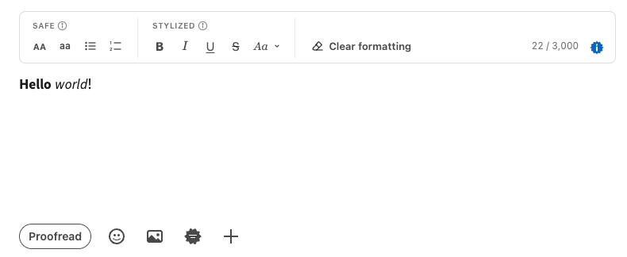
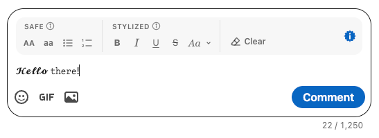
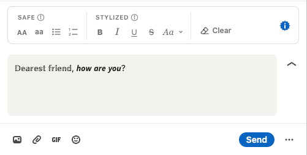

# LinkedIn Text Formatter

A Chrome extension that adds a formatting toolbar to LinkedIn posts, comments and messages.

LinkedIn has no real bold or italic, so the toolbar swaps letters for Unicode look-alikes
(𝗯𝗼𝗹𝗱, 𝘪𝘵𝘢𝘭𝘪𝘤, u̲n̲d̲e̲r̲l̲i̲n̲e̲ …) right inside the editor. No more copy, convert, paste.
It also shows an always-visible character counter, where LinkedIn only warns you once you're over.

| Post | Comment | Message |
|---|---|---|
|  |  |  |

## Install (Chrome)

The extension isn't on the Chrome Web Store yet. For now you install it from this repo:

1. On this page, click the green **Code** button, then **Download ZIP**.
2. Unzip it. You get a folder called `linkedin-text-formatter-main`. Keep it somewhere permanent:
   Chrome loads the extension from that folder, so deleting or moving it removes the extension.
3. In Chrome, go to `chrome://extensions`.
4. Turn on **Developer mode** (switch in the top right corner).
5. Click **Load unpacked** and select the `linkedin-text-formatter-main` folder (the one that contains `manifest.json`).
6. Open LinkedIn, or reload any LinkedIn tab that was already open.

**To update:** download the ZIP again, replace the old folder with the new one, then click the ↻ reload icon on the
extension's card in `chrome://extensions` and reload LinkedIn.

> [!WARNING]
> **Stylized text hurts reach, search and accessibility.** Bold, italic, script and the other stylized styles
> aren't real formatting: they replace your letters with different Unicode symbols that only *look* like letters.
> - **Search:** LinkedIn search and Google don't match 𝗿𝗲𝗰𝗿𝘂𝗶𝘁𝗲𝗿 to "recruiter", so those words can't be found.
> - **Algorithm:** LinkedIn's feed can't read those words either, which may hurt how your post is understood and shown.
> - **Accessibility:** screen readers skip them or spell them out symbol by symbol ("mathematical bold small r…").
>
> Keep stylized text to a few words you want to stand out, never whole paragraphs, keywords or hashtags.
> Messages aren't searched or ranked, so there it only affects accessibility.

## How it works

The toolbar has two groups, plus a **Clear** button.

- **Safe**: UPPERCASE, lowercase, bulleted and numbered lists. Plain characters, so LinkedIn search,
  Google and screen readers read them normally.
- **Stylized** ⚠️: Bold, Italic, Underline, Strikethrough, plus Serif bold, Script, Double-struck and Monospace
  in the `Aa` menu. Unicode look-alikes with the downsides above.
  Styles combine (Bold + Italic) and toggle (Bold again removes it).
- **Clear** turns stylized text back into plain letters. Also handy for pasted text.

Select text and click a button, or click a stylized button with nothing selected to style what you type next.
Shortcuts: ⌘/Ctrl+B, ⌘/Ctrl+I, ⌘/Ctrl+U. Accented letters (é, ñ …) keep their accent.

**The counter** shows `x / 3,000` on posts and `x / 1,250` on comments. LinkedIn counts every stylized letter
as 2 characters, and so does the counter.

## Roadmap

- **Clearer warnings in the toolbar** when a style hurts reach, search or accessibility, right where you apply it,
  not only in the ⓘ tooltips.
- Chrome Web Store release, so you no longer need Developer mode.
- Other browsers.

Ideas welcome, see below.

## Feedback, bugs and feature requests

- Open an [issue on GitHub](https://github.com/SimonDiff/linkedin-text-formatter/issues), or
- Send me a DM on [LinkedIn](https://www.linkedin.com/in/simondiff/).

Want to contribute code? See [CONTRIBUTING.md](CONTRIBUTING.md).

For bugs, say where it happened (post, comment or message) and add a screenshot if you can.
LinkedIn changes its page often, so the toolbar sometimes stops showing up in one place: that's the most useful thing to report.

## Fork it for other scripts

This version only styles the basic Latin alphabet (A–Z, a–z, digits and accented Latin letters),
because that's what Unicode's "mathematical" look-alike letters cover. Greek, Cyrillic, Arabic, Hebrew,
Devanagari, CJK and many other writing systems aren't served by it, but they may have their own tricks
(combining marks, alternative forms, fullwidth characters …).

If you write in one of those, please fork this repo and make it yours. All the character mapping lives in
[`src/unicode.js`](src/unicode.js), with no dependency on the rest of the code, and it has its own tests.
Open an issue or DM me if you build one: I'll link to it from here.

## For developers

No build step: plain JavaScript, Manifest V3. After editing a file, hit ↻ on the extension's card and reload LinkedIn.

| File | What it does |
|---|---|
| `src/unicode.js` | Formatting engine. Pure functions, no DOM. |
| `src/editor.js` | Reads the selection and writes back through the same input events as typing, so LinkedIn's editor stays in sync and undo works. |
| `src/toolbar.js` | Toolbar UI (Shadow DOM). |
| `src/content.js` | Finds editors as LinkedIn adds them and attaches a toolbar to each. |
| `src/config.js` | LinkedIn selectors, character limits, counter calibration. |

**Toolbar not showing up somewhere?** LinkedIn's class names change often, and every LinkedIn-specific
selector lives in `src/config.js`. The extension logs to the DevTools console at the **Verbose** level,
prefixed `[LTF]` (type `[LTF]` in the console filter). Look for `unclassified editor` lines: they tell you what to add.

**Tests:**

```sh
node --test tests/*.test.js
```

## License

[MIT](LICENSE) © Simon Diff
